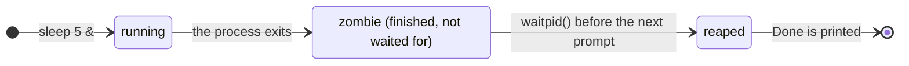

# OS Lab 2 (2026) — Shell Program

## 1. Overview

You will finish a Unix shell program. The parser, the job list and the main loop are provided.
You implement the parts that create processes, connect their file descriptors, and wait for them.
The only API you may not have used before, `open()`, is explained in section 7.

Each step builds on the one before it:

```
1-1 external → 1-2 built-in → 2-1 redirection → 2-2 a pipe → 2-3 pipelines → 3-1 background → 3-2 reaping
└──────── Level 1 ────────┘  └──────────────── Level 2 ───────────────┘  └──────── Level 3 ────────┘
```

| Step | Idea | After this step you can… | …but try this → next step |
|---|---|---|---|
| 1-1 | `fork` → `exec` → `wait` | `echo hello`, `echo $?` | `cd /tmp` does not change the directory |
| 1-2 | some commands must run inside the shell | `cd`, `exit` | output can only go to the screen |
| 2-1 | `dup2` a file onto fd 0 / 1 | `sort < in.txt > out.txt` | two commands cannot work together |
| 2-2 | `pipe` + `dup2`, close unused ends | `cat f \| grep x` | three or more commands? a lot of data? |
| 2-3 | all processes run at the same time | `cat f \| grep x \| wc -l` | a long command blocks the shell |
| 3-1 | the parent does not wait | `sleep 10 &` | finished background jobs are never collected |
| 3-2 | non-blocking `waitpid` | `Done` is reported, no zombies | — |

### Terms

| Term | Meaning |
|---|---|
| process | one running program (one `fork()`) |
| job | one command line; it may contain several processes (a pipeline) |
| background job | a job started with `&`; the shell does not wait for it |
| zombie | a child that has exited but has not been waited for yet |
| reap | wait for a finished child, collecting its exit status so the zombie disappears |

## 2. Grading

| Item | Points |
|---|---|
| Level 1 — Commands: 1-1, 1-2 | 2 (1 each) |
| Level 2 — Redirection and pipes: 2-1, 2-2, 2-3 | 3 (1 each) |
| Level 3 — Background jobs: 3-1, 3-2 | 2 (1 each) |
| Handwritten quiz (closed book, on demo day) | 3 |
| **Total** | **10** |

- `grade.sh` runs **42 fixed checks**. A requirement earns its point only if **all** of its checks pass.
- The checks are listed under each requirement below; run them as often as you like.
- Demo: run `./grade.sh` on your own machine in front of the TA. The TA compares the checksum on its
  last line with the official one on the course GitHub page:

  **Grader checksum: `df332e53a95e`**

  `grade.sh` also compares it with this README and warns you if they differ (an old or modified
  grader: run `git pull`, or restore `grade.sh` and `tests/`).

## 3. Files

```
os_2026_lab2_template/
├── grade.sh            grader
├── data.txt            sample input used in the examples (the grader uses its own copy)
├── include/shell.h     data structures and prototypes
├── src/main.c          provided: main loop
├── src/parser.c        provided: command-line parser
├── src/jobs.c          provided: job list, Done messages
├── src/builtin.c       pwd, exit provided; YOUR WORK: cd
├── src/exec.c          YOUR WORK: running commands
└── tests/              grader helper (probe)
```

Each TODO is tagged with its step, e.g. `/* TODO [1-1] ... */`.
Find the work for one step with `grep -n "TODO \[1-1\]" src/*.c`.

### Data structures (provided)

```c
typedef struct process {
    struct process *next;
    char **argv;    /* NULL-terminated */
    char *infile;   /* "<" target, NULL if none */
    char *outfile;  /* ">" target, NULL if none */
    pid_t pid;      /* set after fork() */
    char completed; /* true once the process has been waited for */
    int status;     /* raw status reported by waitpid */
} process;

typedef struct job {
    struct job *next;
    int jid;       /* job number shown as [1], [2], ... */
    char *command; /* original command line, for messages */
    process *first_process;
    char bg;       /* true if the line ends with "&" */
    ...
} job;
```

Provided helpers: `mark_process_status(pid, status)` finds the process with that pid in the job list
and records its status; `report_background_job(j)` prints `[jid] pid` for a new background job.
Global: `last_status` (= `$?`).

Lines marked `(provided)` in `src/exec.c` and `src/builtin.c` are part of the template — keep them.

## 4. Input format

```
cmd args [< in] [> out] | cmd args ... [&]
```

1. Tokens are separated by spaces. No quotes, no globbing.
2. Operators: `|` `<` `>` `&`. `&` may only be the last token.
3. A token that is exactly `$?` is replaced by the exit status of the last command (see the table below).
4. Built-in commands (`cd`, `pwd`, `exit`) do not support pipes, redirection or `&`;
   the shell prints an error instead of running such a line.
5. A line may contain at most 256 words (commands, arguments and operators).

## 5. Output format

| Situation | Output |
|---|---|
| prompt | `>>> $ ` |
| background job started | `[1] 4321` (job number, pid of its last process) |
| background job finished (before the next prompt) | `[1]  Done       sleep 2 &` |
| command not found | `nosuchcmd: command not found` |
| built-in with `\|`, `<`, `>` or `&` | `my_shell: built-in commands do not support pipes, redirection or &` |

### `$?`

| How the command ended | `$?` |
|---|---|
| exited normally | its exit code (`WEXITSTATUS`); for a pipeline, the code of its **last** command |
| command not found | 127 |
| started in the background with `&` | 0 (as in POSIX shells) |
| a redirection file could not be opened | 1 |
| built-in `cd` failed, or a built-in was used with `\|`, `<`, `>`, `&` | 1 |

## 6. Requirements

### Requirement 1-1 — External commands (1 pt)

**Objective.** Run a program: `fork()` a child, `execvp()` the program in the
child, and wait in the shell until it ends. Report its exit status in `$?`.

**Function to complete** (`src/exec.c`)
- `exit_code()` — turn a `waitpid()` status into a `$?` value: `WIFEXITED` → `WEXITSTATUS`,
  otherwise `128 + WTERMSIG`.
- `launch_job()` — `fork()` a child and store its pid in `p->pid` (the child calls `launch_process()`; provided).
- `launch_process()` — `execvp(p->argv[0], p->argv)`; if it returns, print `<cmd>: command not found`
  to stderr and `_exit(127)`.
- `wait_for_job()` — `waitpid()` every process of the job by its own pid (`p->pid`) and pass the result to
  `mark_process_status()`; set `last_status` with `exit_code()` from the first process
  (a single command has only one; 2-3 extends this to pipelines).

**Key APIs:** `fork(2)`, `execvp(3)`, `waitpid(2)`, `_exit(2)`

**Test case & expected result**
```
>>> $ echo hello world
hello world
>>> $ false
>>> $ echo $?
1
>>> $ nosuchcmd
nosuchcmd: command not found
>>> $ echo $?
127
>>> $
```

**Checks (5)**
1. prints the output of a command
2. waits until the command finishes
3. `$?` is the exit status of the command
4. command not found: message, `$?` = 127, shell keeps going
5. no zombies after foreground commands

**Pitfall.** Use `_exit()`, not `exit()`, in the child after a failed `exec`: `exit()` flushes stdio
buffers the child copied from the shell, so output the shell has not flushed yet can be printed twice.

---

### Requirement 1-2 — Built-in commands (1 pt)

**Objective.** `cd` must run inside the shell process. A child created by `fork()` has its own PCB
and its own working directory; if a child calls `chdir()`, the shell does not move.

**Builds on 1-1.** Try `cd /tmp` after 1-1: the directory does not change. That is why `cd` is built in.

**Function to complete** (`src/builtin.c`)
- `builtin_cd()` — `chdir(argv[1])`, or `chdir(getenv("HOME"))` when there is no argument
  (if `HOME` is not set, print `cd: HOME not set`); on failure `perror("cd")` and return 1.
  `pwd` (provided) is an example; `exit` is provided.

**Key APIs:** `chdir(2)`, `getenv(3)`

**Test case & expected result**
```
>>> $ cd /tmp
>>> $ pwd
/tmp
>>> $ cd
>>> $ pwd
/home/student
>>> $ cd /no_such_dir
cd: No such file or directory
>>> $ echo $?
1
>>> $
```

**Checks (5)**
1. `cd` changes the shell's directory
2. later commands run in the new directory
3. `cd` without an argument goes to `$HOME`
4. `cd` to a missing directory: error, `$?` = 1, directory unchanged
5. `exit` ends the shell

---

### Requirement 2-1 — Redirection (1 pt)

**Objective.** Before `exec`, the child replaces fd 0 or fd 1 with a file: `open()` it (section 7),
`dup2()` the new fd onto 0 or 1, and close the original. The shell's own fds never change.

**Builds on 1-1.** The fork/exec/wait stays; the child rewires its fds between `fork` and `exec`.

The child's file descriptors for `echo hi > out.txt` (**bold** = changed by that step):

| fd | after `fork()` | `open("out.txt", ...)` returns 3 | `dup2(3, 1)` | `close(3)`, then `execvp()` |
|---|---|---|---|---|
| 0 | terminal | terminal | terminal | terminal |
| 1 | terminal | terminal | **out.txt** | out.txt |
| 2 | terminal | terminal | terminal | terminal |
| 3 | — | **out.txt** | out.txt | **— (closed)** |

`echo` writes to fd 1 as usual and never knows it is a file. The shell's own fds do not change.

**Function to complete:** `launch_process()`

| Operator | `open()` flags | onto fd |
|---|---|---|
| `<` | `O_RDONLY` | 0 |
| `>` | `O_WRONLY \| O_CREAT \| O_TRUNC`, mode `0644` | 1 |

A command may have both `<` and `>`. If `open()` fails: `perror(filename)` and `_exit(1)`.

**Key APIs:** `open(2)`, `dup2(2)`, `close(2)`

**Test case & expected result**
```
>>> $ wc -l < data.txt
8
>>> $ grep fork < data.txt > fork.txt
>>> $ cat fork.txt
fork creates a new process
fork returns twice
fork and exec work together
>>> $ cat < missing.txt
missing.txt: No such file or directory
>>> $
```

**Checks (7)**
1. `<` reads a file
2. `>` creates a file
3. `>` truncates an existing file
4. `<` and `>` on the same command
5. `<` with a missing file: error message, `$?` = 1
6. `>` to a path that cannot be opened: error message, `$?` = 1
7. the shell's own output is not redirected

---

### Requirement 2-2 — A pipe (1 pt)

**Objective.** Connect two commands: the first writes into a pipe, the second reads from it.
Every process closes the pipe ends it does not use.

**Builds on 2-1.** The same `dup2()`, but the fd comes from `pipe()` instead of `open()`.

For `cat data.txt | grep fork`, `pipe()` returns fd 3 (read end, `mypipe[0]`) and
fd 4 (write end, `mypipe[1]`). The numbers can differ; your code uses `mypipe[]` and `infile`:

| Process | fd operations, in order | Its fds when the program starts |
|---|---|---|
| shell | `pipe()` → 3, 4; fork `cat`; `close(4)`; fork `grep`; `close(3)`; wait | 0, 1, 2: terminal |
| `cat` | `close(3)`; `dup2(4, 1)`; `close(4)`; `execvp()` | 0 terminal, **1 pipe write end**, 2 terminal |
| `grep` | `dup2(3, 0)`; `close(3)`; `execvp()` | **0 pipe read end**, 1 terminal, 2 terminal |

**Function to complete**
- `launch_job()` — before `fork()`, create a pipe if another process follows;
  in the child, close the **next** process's read end before calling `launch_process()`;
  in the parent, close the pipe ends the shell no longer needs and keep the read end as the next
  process's input, in the local variable `infile` (not `p->infile`, which is the `<` file name).
- `launch_process()` — `dup2(infile, 0)` / `dup2(outfile, 1)` for pipe ends, then close the originals.
  File redirection comes after this, so a file overrides a pipe (like bash).

**Key APIs:** `pipe(2)`, `dup2(2)`, `close(2)`

**Test case & expected result**
```
>>> $ cat data.txt | grep fork
fork creates a new process
fork returns twice
fork and exec work together
>>> $ yes | head -n 1
y
>>> $
```

**Checks (7)**
1. two commands connected by a pipe
2. the reader sees end-of-file
3. `yes | head -n 1` terminates
4. a pipe with redirection
5. a file overrides the pipe (`echo pipe > diverted.txt | cat` prints nothing)
6. both processes have only fds 0, 1, 2 open
7. both commands are children of the shell (the shell itself forks each one)

**Pitfalls** — what happens when one of the closes above is missing:

| Missing close | What happens |
|---|---|
| the shell keeps fd 4 (write end) | `grep` never sees end-of-file and waits forever, and so does the shell |
| `cat` keeps fd 3 (read end) | when the reader exits, the writer gets no SIGPIPE: `yes \| head -n 1` never ends |

---

### Requirement 2-3 — Pipelines (1 pt)

**Objective.** Any number of commands. Each pipe's read end becomes the next process's stdin, and
**all processes run at the same time**: fork them all, then wait.

**Builds on 2-2.** The same loop, one pipe per `|`; only `$?` needs the last process.

**Function to complete:** `wait_for_job()` — for a pipeline, `$?` is the status of the **last** process.
If your 2-2 loop is general, the rest of this step (any number of commands, all running at the same
time) needs no new code — the checks below verify it.

**Key APIs:** `pipe(2)`

**Test case & expected result**
```
>>> $ cat data.txt | grep fork | wc -l
3
>>> $ seq 1 100000 | cat | tail -n 1
100000
>>> $
```

**Checks (7)**
1. pipelines of 3 and 5 commands
2. more than 64 KiB through a pipeline
3. the shell waits for every process of a pipeline
4. `$?` of a pipeline is the status of its last command (`true | false` → 1)
5. every process has only fds 0, 1, 2 open
6. a failing command inside a pipeline
7. every command is a child of the shell

**Pitfalls.**
- The job is finished only when **every** process has ended — in `probe sleep 1 | echo hi` the last
  process ends first. Wait for all of them.
- A pipe is a bounded buffer (usually 64 KiB on Linux). If the shell waits for one process before
starting the next, the writer fills the pipe, nobody reads it, and both wait forever.

---

### Requirement 3-1 — Background jobs (1 pt)

**Objective.** A command ending with `&` runs while the shell keeps reading commands:
the parent and the child execute concurrently.

**Builds on 1-1.** Skip `wait_for_job()` for a background job. A foreground command must still wait
only for its own processes, not for background ones.

**Function to complete**
- `launch_job()` — for a background job, do not wait: call `report_background_job(j)`, set `$?` to 0
  and return.
- `launch_process()` — a background job must not read the terminal: a process whose stdin would
  still be the terminal (no pipe, no `<`) gets `/dev/null` as its stdin.

**Key APIs:** `waitpid(2)` with a specific pid, `open(2)`

**Test case & expected result**
```
>>> $ sleep 2 &
[1] 33372
>>> $ echo still working
still working
>>> $
```

**Checks (6)**
1. `&` returns at once, prints `[jid] pid`, `$?` = 0
2. the shell keeps working while a job runs in the background
3. a foreground command waits only for itself
4. job numbers count up
5. a background job does not read the terminal
6. a background pipeline with redirection

---

### Requirement 3-2 — Reaping (1 pt)

**Objective.** A finished child stays in the system until its parent waits for it —
a *zombie*. Before every prompt, collect every finished background process **without blocking**.
The provided code then prints `Done` and removes the job.

**Builds on 3-1.** Background jobs now exist; somebody has to wait for them.



Until the next prompt the finished process stays a zombie: `ps` shows it as `Z` (`<defunct>`).
That is why `Done` appears only after you press Enter or run another command.

**Function to complete** (`src/exec.c`)
- `update_bg_jobs()` — loop `waitpid(-1, &status, WNOHANG)` and pass each pid to
  `mark_process_status()`; stop when it returns 0 (nothing has finished) or -1 (no children).

**Key APIs:** `waitpid(2)` with `WNOHANG`

**Test case & expected result**
```
>>> $ sleep 1 &
[1] 33375
>>> $ sleep 1 &
[2] 33376
>>> $                          ← press Enter after 1 second
[1]  Done       sleep 1 &
[2]  Done       sleep 1 &
>>> $
```

**Checks (5)**
1. a finished job is reported Done exactly once
2. jobs finishing together are all reported
3. no zombies after 30 background jobs
4. a background pipeline is Done when all its processes end
5. the prompt is not blocked while background jobs run

**Pitfalls.**
- Several children can finish between two prompts; one `waitpid()` call collects only one — loop.
- Without `WNOHANG`, `waitpid()` blocks until a background job ends, and the prompt never appears.

## 7. Supplement: `open()`

To redirect to a file you need `open()`, which returns a new fd for a path:

```c
#include <fcntl.h>

int fd = open("out.txt", O_WRONLY | O_CREAT | O_TRUNC, 0644);
if (fd < 0) {
    perror("out.txt");   /* e.g. "out.txt: Permission denied" */
    _exit(1);
}
dup2(fd, STDOUT_FILENO); /* fd 1 now refers to out.txt */
close(fd);               /* fd 1 keeps the file open */
```

| Flag | Meaning |
|---|---|
| `O_RDONLY` | open for reading |
| `O_WRONLY` | open for writing |
| `O_CREAT` | create the file if it does not exist (needs the mode argument, e.g. `0644`) |
| `O_TRUNC` | if the file exists, cut it to length 0 first |

## 8. Limitations (by design)

This shell has no job control: there is no `fg`, `bg`, `jobs`, and no Ctrl-Z.
Ctrl-C stops the shell together with its jobs, because the terminal sends the signal to all of them.
Real shells avoid this with process groups and terminal control, which this lab does not cover.

## 9. Testing your shell

```
make                         # build with your Makefile while developing
./my_shell                   # try it by hand
./grade.sh                   # run all 42 checks
./grade.sh -v                # list every check
GRADER_ONLY=2-2 ./grade.sh   # run only the checks of one step
```

`grade.sh` builds your code with its own command (`gcc -Wall -Iinclude src/*.c`) — your Makefile is
not used. It needs Linux (Ubuntu 24.04 recommended: VM, WSL2 or container), `gcc` and `python3`.

## 10. Precautions

- Implement in **C**. Your work goes in `src/exec.c` and `builtin_cd()` in `src/builtin.c`.
- `system()`, `popen()` and running commands through another shell (`bash -c`, `sh -c`) are not
  allowed: the shell itself must `fork()` and `exec` every command.
- Do not modify `grade.sh` or `tests/`; the TA checks the grader checksum at the demo.
- You may use any reference, including LLMs. The closed-book quiz asks about the concepts in this lab
  and about your own code.

## 11. References

- man pages: https://man7.org/linux/man-pages/ — `fork(2)`, `execvp(3)`, `waitpid(2)`, `chdir(2)`,
  `open(2)`, `dup2(2)`, `pipe(2)`, `pipe(7)`
